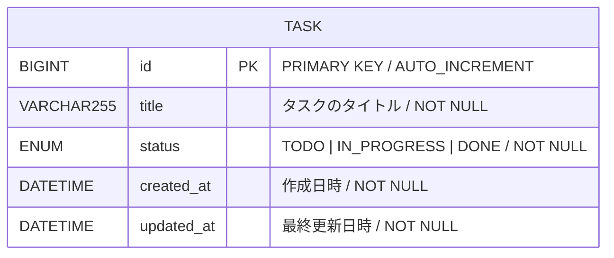
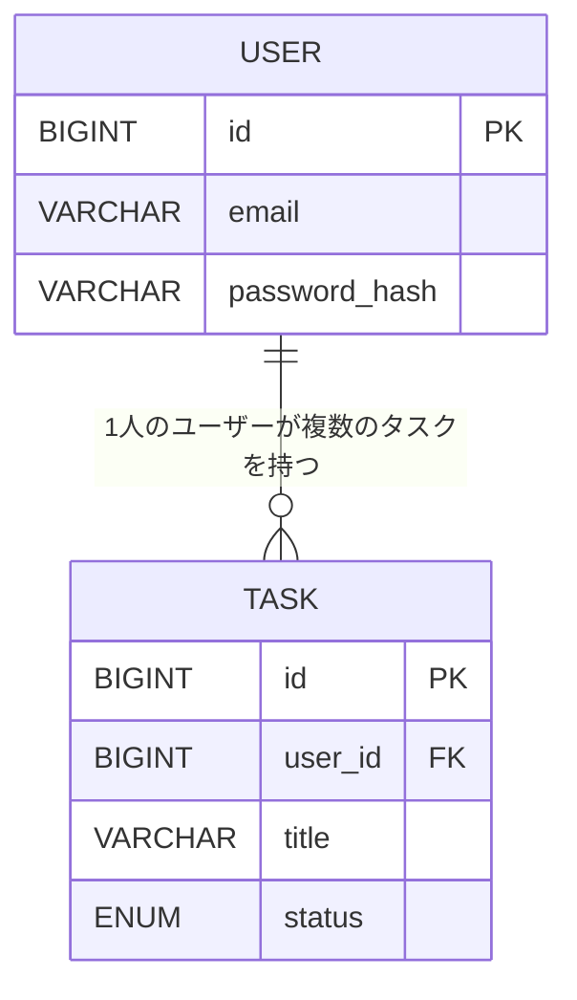

# ER図 — タスク管理アプリ

| 項目 | 内容 |
|------|------|
| バージョン | 1.0 |
| 作成日 | 2026年10月14日 |

---

## ER図



---

## テーブル定義

### TASK テーブル

| カラム名 | 型 | 制約 | 説明 |
|---------|-----|------|------|
| `id` | `BIGINT` | PRIMARY KEY, AUTO_INCREMENT | タスクの一意識別子 |
| `title` | `VARCHAR(255)` | NOT NULL | タスクのタイトル |
| `status` | `ENUM` | NOT NULL, DEFAULT `'TODO'` | 進捗ステータス |
| `created_at` | `DATETIME` | NOT NULL | 作成日時（自動設定） |
| `updated_at` | `DATETIME` | NOT NULL | 最終更新日時（自動更新） |

### status の取りうる値

| 値 | 画面表示名 | 説明 |
|----|-----------|------|
| `TODO` | 未着手 | まだ着手していないタスク |
| `IN_PROGRESS` | 進行中 | 現在対応中のタスク |
| `DONE` | 完了 | 完了したタスク |

---

## 設計の補足

**なぜテーブルが1つか**

現在のスコープでは「個人利用・認証なし」のため、ユーザーテーブルは不要。
タスクデータを管理する `TASK` テーブル1つで成立する。

**将来的な拡張について（スコープ外）**

ユーザー認証を追加する場合、以下のような構成に拡張できる。



---

## DDL（テーブル作成SQL）

Spring Bootのプロジェクトで使用するテーブル作成用SQLの参考。

```sql
CREATE TABLE task (
    id         BIGINT       NOT NULL AUTO_INCREMENT,
    title      VARCHAR(255) NOT NULL,
    status     ENUM('TODO', 'IN_PROGRESS', 'DONE') NOT NULL DEFAULT 'TODO',
    created_at DATETIME     NOT NULL DEFAULT CURRENT_TIMESTAMP,
    updated_at DATETIME     NOT NULL DEFAULT CURRENT_TIMESTAMP ON UPDATE CURRENT_TIMESTAMP,
    PRIMARY KEY (id)
);
```
