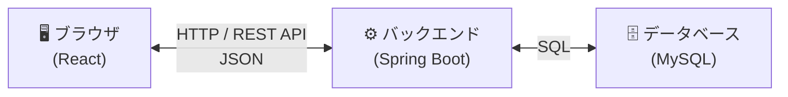
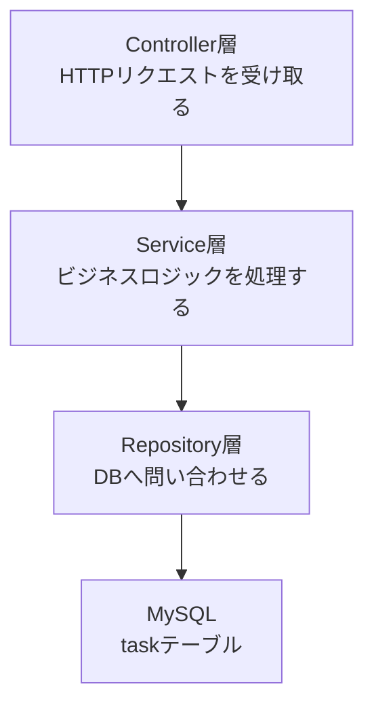
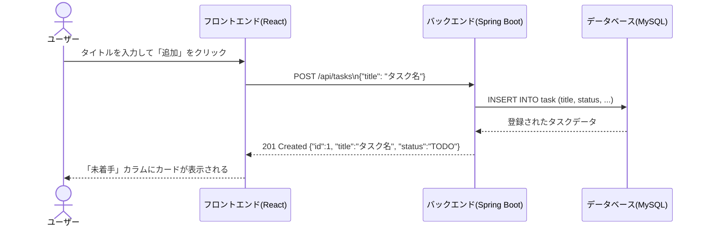
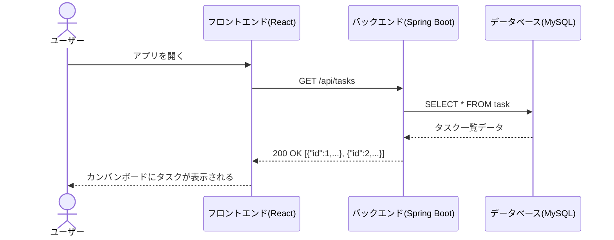
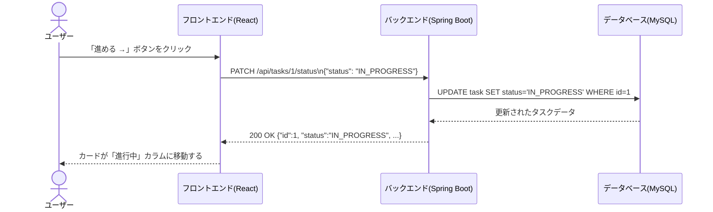
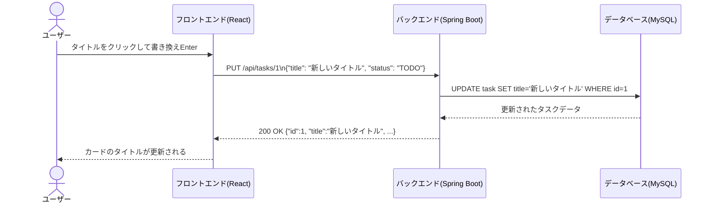
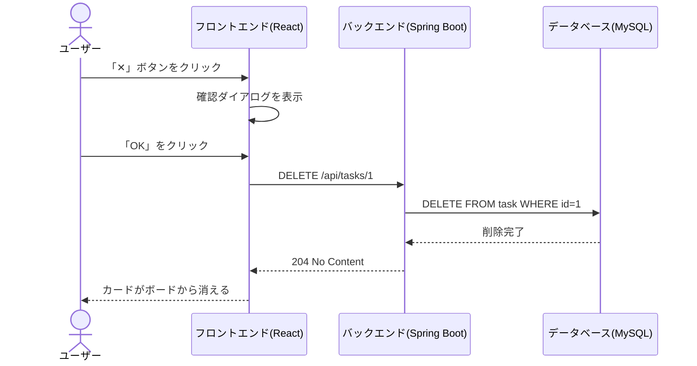
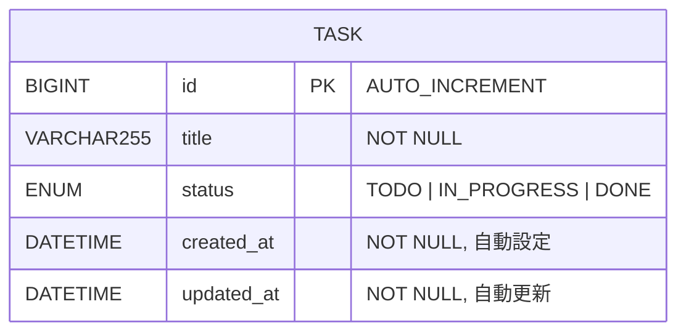
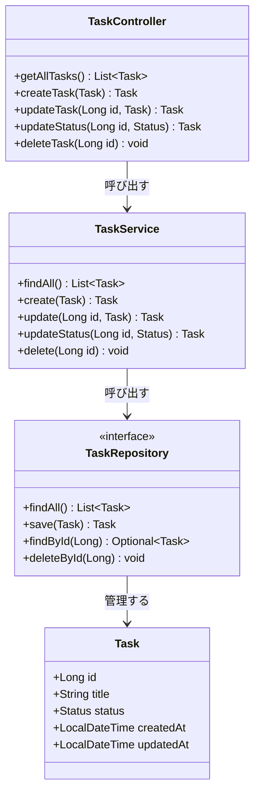

# 要件定義書 — タスク管理アプリ（カンバン形式）

| 項目 | 内容 |
|------|------|
| ドキュメント種別 | 要件定義書 |
| バージョン | 3.0 |
| 作成日 | 2026年10月13日 |
| 最終更新日 | 2026年10月14日 |
| ステータス | 改訂済み |

---

## 改訂履歴

| バージョン | 日付 | 変更内容 |
|-----------|------|---------|
| 1.0 | 2026年10月13日 | 初版作成 |
| 2.0 | 2026年10月14日 | システム構成・画面一覧・データ要件・API概要・前提条件を追加 |
| 3.0 | 2026年10月14日 | Mermaid図を追加（システム構成図・シーケンス図・クラス図・ER図） |

---

## 目次

1. [プロジェクト概要](#1-プロジェクト概要)
2. [前提条件・制約](#2-前提条件制約)
3. [対象ユーザー](#3-対象ユーザー)
4. [用語集](#4-用語集)
5. [システム構成](#5-システム構成)
6. [機能要件](#6-機能要件)
7. [ユースケース](#7-ユースケース)
8. [画面一覧](#8-画面一覧)
9. [データ要件（ER図）](#9-データ要件er図)
10. [バックエンド設計](#10-バックエンド設計)
11. [API仕様](#11-api仕様)
12. [非機能要件](#12-非機能要件)
13. [スコープ外](#13-スコープ外)

---

## 1. プロジェクト概要

**背景・課題**
タスクをメモや頭の中だけで管理していると、何が終わっていて何が残っているかが不明確になりやすい。

**目的**
カンバンボード形式のタスク管理アプリを構築し、タスクを「未着手・進行中・完了」の3ステータスで視覚的に管理できるようにする。

**成果物**

| 成果物 | 説明 |
|--------|------|
| Webアプリケーション | ブラウザで動作するタスク管理システム |
| ソースコード | GitHub上で管理・納品 |
| 本要件定義書 | 仕様の合意文書 |

---

## 2. 前提条件・制約

| 分類 | 内容 |
|------|------|
| **開発環境** | Java 21以上、Node.js 18以上がインストールされていること |
| **実行環境** | 最新バージョンのChrome・Edge・Safariで動作すること |
| **データ保存** | データはサーバーサイドのデータベースに永続化する |
| **認証** | 今回のスコープではユーザー認証は実装しない |
| **利用人数** | 個人利用（1ユーザー）を前提とする |
| **ソース管理** | GitHubにてソースコードを管理する |

---

## 3. 対象ユーザー

| 項目 | 内容 |
|------|------|
| 主なユーザー | システムの利用者本人（個人利用） |
| 利用シーン | 学習・日常業務・プロジェクトのタスクを管理するとき |
| 想定デバイス | PC（メイン）／スマートフォン（サブ） |
| 技術レベル | 基本的なWeb操作ができれば使える（専門知識は不要） |

---

## 4. 用語集

| 用語 | 説明 |
|------|------|
| **カンバンボード** | タスクを列（カラム）に分けて進捗を管理する手法 |
| **カラム** | ボード上の縦列。「未着手」「進行中」「完了」の3つ |
| **カード** | 1つのタスクを表す表示単位 |
| **ステータス** | タスクの進捗状態。`TODO`・`IN_PROGRESS`・`DONE` の3種類 |
| **REST API** | フロントエンドとバックエンドが通信するための接続口 |
| **CRUD** | Create・Read・Update・Delete の頭文字。データ操作の基本4種類 |
| **エンティティ** | DBのテーブルに対応するJavaのクラス |
| **リポジトリ** | DBへの問い合わせ（SELECT/INSERT等）を担当するクラス |
| **サービス** | ビジネスロジックを担当するクラス |
| **コントローラー** | HTTPリクエストを受け取りレスポンスを返すクラス |

---

## 5. システム構成

### 技術スタック

| レイヤー | 技術 | バージョン |
|---------|------|-----------|
| フロントエンド | React | 最新安定版 |
| バックエンド | Spring Boot（Java） | 4.1.0 |
| データベース | MySQL | 8.0 |
| バージョン管理 | GitHub | - |

### システム構成図



### レイヤー構成（バックエンド内部）



---

## 6. 機能要件

> **必須** = 必ず実装する機能 / **任意** = 余裕があれば追加する機能

| ID | 機能名 | 説明 | 優先度 |
|----|--------|------|--------|
| F-01 | タスク一覧表示（Read） | 登録済みのタスクをカンバンボード形式で表示する | 必須 |
| F-02 | タスク新規登録（Create） | タイトルを入力して新しいタスクを作成できる | 必須 |
| F-03 | タスクステータス更新（Update） | タスクを「未着手→進行中→完了」と進められる | 必須 |
| F-04 | タスク内容編集（Update） | タスクのタイトルを後から変更できる | 必須 |
| F-05 | タスク削除（Delete） | 不要なタスクを削除できる（確認あり） | 必須 |
| F-06 | カラム別表示 | ステータスごとに列を分けて表示する | 必須 |
| F-07 | カード枚数表示 | 各カラムにタスク枚数をバッジで表示する | 任意 |
| F-08 | ドラッグ＆ドロップ | カードをドラッグして列間を移動できる | 任意 |

---

## 7. ユースケース

### UC-01 タスクを追加する（Create）



**例外：** タイトルが空の場合 → `400 Bad Request` を返す

---

### UC-02 タスク一覧を表示する（Read）



---

### UC-03 タスクを進める（Update ステータス）



---

### UC-04 タスクを編集する（Update タイトル）



---

### UC-05 タスクを削除する（Delete）



---

## 8. 画面一覧

このアプリは **1画面構成（シングルページ）** で構成される。

| 画面ID | 画面名 | 説明 |
|--------|--------|------|
| S-01 | メインボード画面 | カンバンボード全体を表示するメイン画面 |
| S-02 | タスク追加モーダル | タスクのタイトルを入力して追加するポップアップ |
| S-03 | タスク編集（インライン） | カード上で直接タイトルを編集できる入力欄 |

**S-01 メインボード画面 レイアウト**

```
┌─────────────────────────────────────────────┐
│  📋 タスク管理ボード              [＋ 追加]  │
├───────────────┬───────────────┬─────────────┤
│  未着手  [2]  │  進行中  [1]  │  完了  [0]  │
├───────────────┼───────────────┼─────────────┤
│ ┌───────────┐ │ ┌───────────┐ │             │
│ │ タスクA   │ │ │ タスクC   │ │             │
│ │ [→][✕]   │ │ │ [←][→][✕]│ │             │
│ └───────────┘ │ └───────────┘ │             │
│ ┌───────────┐ │               │             │
│ │ タスクB   │ │               │             │
│ │ [→][✕]   │ │               │             │
│ └───────────┘ │               │             │
└───────────────┴───────────────┴─────────────┘
```

---

## 9. データ要件（ER図）



### ステータスの定義

| 値 | 画面表示名 | 説明 |
|----|-----------|------|
| `TODO` | 未着手 | まだ着手していないタスク |
| `IN_PROGRESS` | 進行中 | 現在対応中のタスク |
| `DONE` | 完了 | 完了したタスク |

---

## 10. バックエンド設計

### クラス構成図



### 各クラスの役割

| クラス | パッケージ | 役割 |
|--------|-----------|------|
| `TaskController` | `controller` | HTTPリクエストを受け取り、レスポンスを返す |
| `TaskService` | `service` | ビジネスロジック（データの検証・加工）を担当する |
| `TaskRepository` | `repository` | DBへの問い合わせを担当する（Spring Data JPAが自動実装） |
| `Task` | `entity` | DBの `task` テーブルに対応するJavaのクラス |

---

## 11. API仕様

### エンドポイント一覧

| メソッド | エンドポイント | 機能 | ステータスコード |
|---------|--------------|------|----------------|
| `GET` | `/api/tasks` | タスク全件取得 | 200 OK |
| `POST` | `/api/tasks` | タスク新規登録 | 201 Created |
| `PUT` | `/api/tasks/{id}` | タスク内容更新（タイトル変更） | 200 OK |
| `PATCH` | `/api/tasks/{id}/status` | ステータス更新 | 200 OK |
| `DELETE` | `/api/tasks/{id}` | タスク削除 | 204 No Content |

### リクエスト・レスポンス例

**POST /api/tasks — タスク新規登録**

```json
// リクエスト
{
  "title": "要件定義書を作成する"
}

// レスポンス（201 Created）
{
  "id": 1,
  "title": "要件定義書を作成する",
  "status": "TODO",
  "createdAt": "2026-10-14T20:00:00",
  "updatedAt": "2026-10-14T20:00:00"
}
```

**PATCH /api/tasks/1/status — ステータス更新**

```json
// リクエスト
{
  "status": "IN_PROGRESS"
}

// レスポンス（200 OK）
{
  "id": 1,
  "title": "要件定義書を作成する",
  "status": "IN_PROGRESS",
  "createdAt": "2026-10-14T20:00:00",
  "updatedAt": "2026-10-14T20:05:00"
}
```

### エラーレスポンス

| HTTPステータス | 意味 | 発生ケース |
|--------------|------|-----------|
| `400 Bad Request` | リクエストの内容が不正 | タイトルが空、ステータスの値が不正 |
| `404 Not Found` | 対象データが存在しない | 指定した `id` のタスクがない |
| `500 Internal Server Error` | サーバー内部エラー | DB接続失敗など予期しないエラー |

---

## 12. 非機能要件

| 分類 | 要件 |
|------|------|
| **動作環境** | 最新バージョンのChrome・Edge・Safariで正常に動作すること |
| **レスポンシブ** | PC（1280px以上）・スマートフォン（400px程度）で崩れずに表示されること |
| **パフォーマンス** | API応答時間が通常3秒以内であること |
| **データ永続性** | タスクデータはDBに保存し、サーバー再起動後もデータが保持されること |
| **セキュリティ** | 入力値はバックエンドでバリデーションを行い、不正なデータの登録を防ぐこと |
| **保守性** | フロントエンド（React）とバックエンド（Spring Boot）を分離した構成にすること |
| **ソース管理** | GitHubのリポジトリで管理し、変更履歴を追跡できること |

---

## 13. スコープ外（今回は作らないもの）

| 機能 | 理由 |
|------|------|
| ユーザー認証（ログイン・ログアウト） | 個人利用のためスコープ外 |
| 複数ユーザーでの共同利用 | 認証機能が前提となるためスコープ外 |
| タスクの期限・優先度設定 | 初版では基本機能のみに絞る |
| 通知機能（リマインダー） | スコープを広げすぎないため対象外 |
| ドラッグ＆ドロップ移動 | ボタン操作で代替できるため任意扱い |
